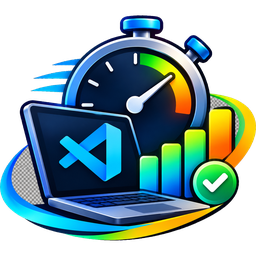
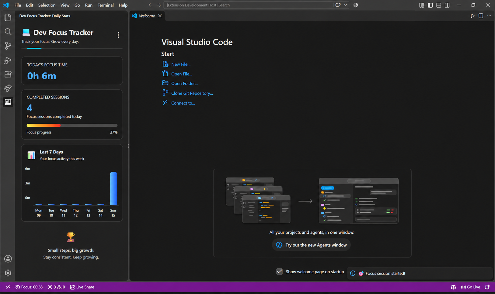
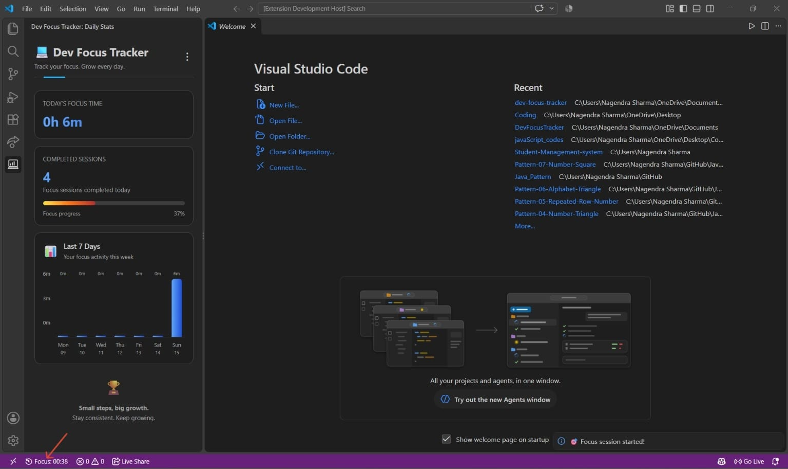
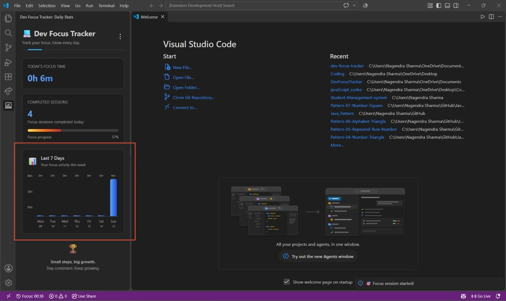

# Dev Focus Tracker

 <!-- EXTENSION LOGO -->
    

<h1 align="center">Dev Focus Tracker</h1>

<h3 align="center">Focus Better. Code Smarter.</h3>

    Your productivity companion, built right into Visual Studio Code.

    <a href="vscode:extension/bytemate.dev-focus-tracker">
        <strong>Install Dev Focus Tracker in VS Code →</strong>
    </a>

---

## 🚀 Your Coding Time. Better Managed.

Dev Focus Tracker helps developers build consistent work habits with focused work sessions, scheduled breaks, and clear productivity insights — without leaving their coding environment.

Whether you're learning to code, working on a personal project, or building software professionally, Dev Focus Tracker helps you make every coding session count.

---

## ✨ Why Dev Focus Tracker?

Staying productive isn't just about writing more code. It's about managing your time, maintaining focus, and taking breaks when needed.

Dev Focus Tracker brings your focus routine and productivity tracking directly into VS Code.

### Everything You Need to Stay Focused

| Feature | Description |
|:---|:---|
| 🎯 **Focus Timer** | Start dedicated work sessions and concentrate on your tasks. |
| ☕ **Break Timer** | Take breaks after completing focus sessions. |
| ⏯️ **Pause & Resume** | Pause your current session and continue whenever you're ready. |
| ⏹️ **Stop Session** | End an active focus or break session at any time. |
| ⚙️ **Customizable Durations** | Configure focus and break durations to match your workflow. |
| 📊 **Daily Productivity Stats** | Track your total focus time and completed focus sessions. |
| 📈 **Weekly Productivity Chart** | Review your focus activity over the last seven days. |
| 🔄 **Visual Progress Bar** | See how much of your current session is complete. |
| 💾 **Persistent Statistics** | Your productivity data remains available when VS Code restarts. |
---

## 🖥️ See It in Action

Get a closer look at how Dev Focus Tracker fits into your development workflow.

### Your Productivity Dashboard

<!-- DASHBOARD SCREENSHOT -->

    

### Stay Focused with the Focus Timer

<!-- FOCUS TIMER SCREENSHOT -->

    

### Track Your Productivity

<!-- PRODUCTIVITY STATISTICS SCREENSHOT -->

    

---

## 📥 Installation

### Install from Visual Studio Marketplace

1. Open Visual Studio Code.
2. Open the Extensions view using `Ctrl + Shift + X`.
3. Search for **Dev Focus Tracker**.
4. Select the extension published by **ByteMate**.
5. Click **Install**.

    <a href="https://marketplace.visualstudio.com/items?itemName=bytemate.dev-focus-tracker">
        <strong>Get Dev Focus Tracker on Visual Studio Marketplace →</strong>
    </a>

---

## 📖 How to Use

Get started with Dev Focus Tracker in just a few simple steps.

### 1. Open Dev Focus Tracker

- Open Visual Studio Code.
- Find the Dev Focus Tracker icon in the Activity Bar.
- Click the icon to open the extension dashboard.

### 2. Configure Your Session Duration

- Open VS Code Settings.
- Search for **Dev Focus Tracker**.
- Choose your preferred focus duration.
- Set your preferred break duration.

Customize the durations according to your working style.

### 3. Start a Focus Session

- Open the Dev Focus Tracker dashboard.
- Start your focus session.
- The countdown timer will begin.
- Work on your coding tasks while the session is active.
- Follow the visual progress bar to track your session.

### 4. Manage Your Timer

While a session is active, use the available controls:

- **Pause:** Temporarily pause the active timer.
- **Resume:** Continue a paused session.
- **Stop:** End the current session.

### 5. Take a Break

- When your focus session completes, the break session starts.
- The break timer tracks your remaining break time.
- Use this time to step away from your screen and recharge.
- Once the break is complete, you're ready for another focus session.

### 6. Review Your Productivity

Open the dashboard to review your productivity statistics:

- Total focus time for today.
- Completed focus sessions.
- Weekly focus activity.
- Current session progress.

Use these insights to understand your work habits and build a more consistent routine.

---

## ⚙️ Settings & Customization

Dev Focus Tracker lets you customize your focus and break durations.

To configure your preferences:

1. Open Visual Studio Code Settings using `Ctrl + ,`.
2. Search for **Dev Focus Tracker**.
3. Locate the available focus and break duration settings.
4. Choose the durations that work best for you.

Your workflow should fit your needs. Start with manageable sessions and adjust them as you build consistency.

---

## 📊 Build Better Work Habits

Dev Focus Tracker is designed to help you:

- Stay consistent with focused work sessions.
- Take regular breaks.
- Understand how much time you spend focusing.
- Monitor your productivity over time.
- Build a healthier and more structured coding routine.

Small, consistent improvements can make a meaningful difference.

---

## 🛠️ Built With

- JavaScript
- Visual Studio Code Extension API
- HTML
- CSS

---

## 🤝 Feedback & Support

Have a suggestion, found a bug, or want to request a feature?

Your feedback helps improve Dev Focus Tracker.

- [Report an Issue](https://github.com/SonuSharma-creator/Dev-Focus-Tracker/issues)
- [View GitHub Repository](https://github.com/SonuSharma-creator/Dev-Focus-Tracker)

---

## 🗺️ What's Next?

Dev Focus Tracker is continuously evolving. Future improvements may include additional productivity insights, enhanced customization, and more ways to manage focus sessions.

Stay tuned for future updates!

&#x20; <strong>Made for developers who value their time.</strong>

<h3 align="center">Dev Focus Tracker — Focus. Track. Improve.</h3>